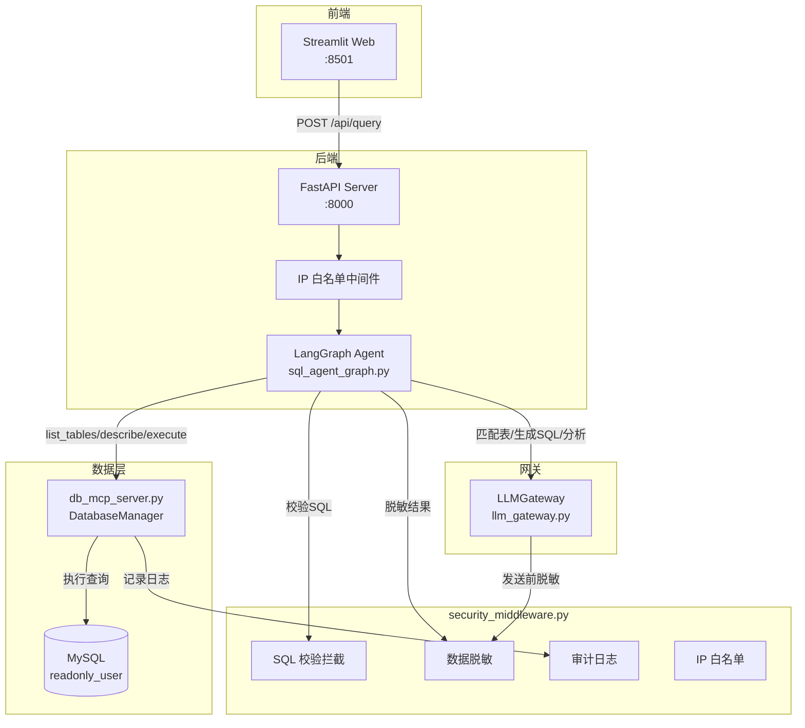
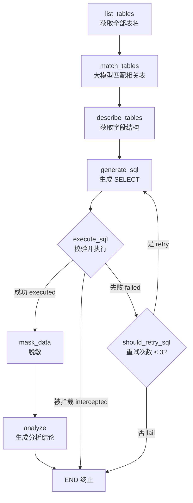
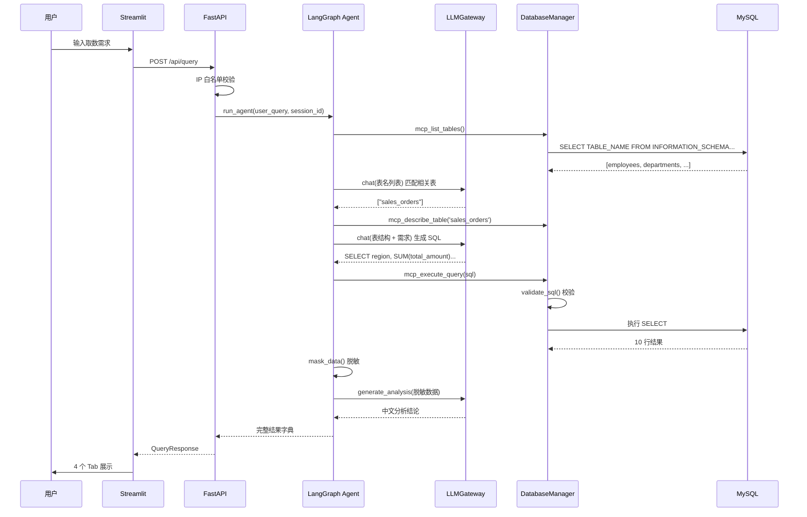

# 企业内网自主取数智能体 · 开发文档

> 文档版本: v2.1 | 更新日期: 2026-10-25 | 适用对象: 后端/算法/运维工程师
>
> 本文面向参与本项目的开发者,系统梳理系统的架构设计、核心模块实现、智能体工作流、安全机制、数据模型、部署方式与扩展方法。阅读本文前建议先通读 `README.md` 了解项目的使用视角。

> V2 新增的分析计划、HITL、Python 沙箱、RAG、报告、模型注册、API Key 与 MCP 架构详见 `V2_ARCHITECTURE.md`；本文其余章节保留对 v1 Text-to-SQL 内核的详细说明。

---

## 1. 项目概述

本项目是一个部署在企业内网的自然语言自助取数服务。用户用中文描述取数需求,系统自动完成「理解需求 → 匹配数据表 → 生成 SQL → 安全校验 → 执行查询 → 数据脱敏 → 生成业务分析」的完整闭环。

| 能力 | 说明 |
|------|------|
| 自然语言取数 | 输入业务需求,AI 自动查表、生成 SQL、执行查询 |
| 安全合规 | 高危 SQL 拦截、敏感数据脱敏、只读账号、IP 白名单 |
| 审计追溯 | 全操作不可删除的追加式审计日志 |
| 内网部署 | 纯后端服务,Windows / Linux 跨平台 |
| 国产大模型 | 对接 OpenAI 兼容格式的国内大模型(DeepSeek / 通义千问等) |

### 1.1 设计目标

1. **低门槛取数**:业务人员无需懂 SQL,用自然语言即可完成数据查询与统计。
2. **安全可控**:通过「SQL 正则拦截 + 数据库只读账号 + 数据脱敏 + IP 白名单」四道防线,保证数据不出内网、不外泄。
3. **可追溯**:每一次取数请求都留痕,支持事后审计。
4. **模块解耦**:大模型调用、数据库访问、安全校验、Agent 编排各自独立,便于替换与扩展。

---

## 2. 技术栈与运行环境

| 分类 | 技术 | 版本 | 用途 |
|------|------|------|------|
| 语言 | Python | 3.11+ | LangChain、LangGraph 与 FastMCP 统一运行基线 |
| Agent 组件 | LangChain | 1.4.7 | 模型、Embedding、Retriever 与 Tool 抽象 |
| Agent 编排 | LangGraph | 1.2.17 | 有状态图调度、HITL 与分析流程 |
| 后端框架 | FastAPI | 0.162.0 | RESTful API 服务 |
| ASGI 服务器 | uvicorn | 0.54.0 | 启动 FastAPI |
| 数据校验 | Pydantic | 2.14.1 | 请求/响应模型 |
| 前端 | Streamlit | 1.66.1 | 轻量化 Web 页面 |
| 数据库驱动 | PyMySQL | 1.1.0 | MySQL 连接(只读) |
| 模型适配 | langchain-openai | 1.7.2 | OpenAI-compatible Chat/Embedding API |
| 配置管理 | python-dotenv | 1.2.4 | 读取 `.env` |
| MCP 框架 | FastMCP | 4.1.3 | Tool/Resource Server 与协议传输 |

> **运行基线**:从 v2.1.0 起项目要求 Python 3.11+。进程内数据库函数供 LangGraph 节点调用，`mcp_server_v2.py` 则通过 FastMCP 向外部 MCP Client 暴露完整能力。

---

## 3. 系统架构

### 3.1 总体架构



### 3.2 模块依赖关系

```
streamlit_web.py  ──(HTTP)──►  fastapi_server.py  ──►  sql_agent_graph.py
                                                          │
                     ┌────────────────────────────────────┼───────────────────────┐
                     ▼                                    ▼                       ▼
              db_mcp_server.py                    llm_gateway.py          security_middleware.py
                     │                                    │                       ▲
                     ▼                                    ▼                       │
                (MySQL)                          (DeepSeek API)  ───────────────┘
```

依赖方向单向、清晰:

- `streamlit_web.py` 只依赖 `fastapi_server.py`(通过 HTTP)。
- `fastapi_server.py` 依赖 `sql_agent_graph.py` 与 `security_middleware.py`。
- `sql_agent_graph.py` 依赖 `db_mcp_server.py`、`llm_gateway.py`、`security_middleware.py`。
- `llm_gateway.py` 依赖 `security_middleware.py`(发送前脱敏)。
- `db_mcp_server.py` 依赖 `security_middleware.py`(SQL 校验 + 审计)。
- `security_middleware.py` 为**无业务依赖的纯函数工具包**,是整座「依赖塔」的地基。

---

## 4. 目录结构

```
project_root/
├── .env                     # 环境变量配置(含真实密钥,严禁提交)
├── security_middleware.py   # 安全工具包:脱敏 / SQL 拦截 / 审计日志 / IP 白名单
├── llm_gateway.py           # 大模型统一调用网关
├── db_mcp_server.py         # 数据库 MCP 工具服务(连接管理 + 工具函数)
├── sql_agent_graph.py       # LangGraph 取数智能体核心循环
├── fastapi_server.py        # FastAPI 后端接口服务
├── streamlit_web.py         # Streamlit 轻量化 Web 页面
├── rebuild_db.py            # 数据库一键初始化重建脚本
├── test_api.py              # 命令行 API 冒烟测试脚本
├── fix_helper.py            # 一次性辅助脚本(对齐 _json_default 实现)
├── requirements.txt         # 依赖清单
├── start.bat                # Windows 一键启动脚本
├── start.sh                 # Linux 一键启动脚本
├── README.md                # 使用文档
├── init_db.sql              # 数据库初始化 SQL(参考用,推荐用 rebuild_db.py)
├── init_mysql.sql           # 数据库初始化 SQL(参考用,推荐用 rebuild_db.py)
├── logs/
│   └── audit.log            # 审计日志(自动生成,追加写)
└── outputs/                 # 预留输出目录
```

> 说明:`init_db.sql` / `init_mysql.sql` 是早期的 SQL 初始化脚本。由于 Windows cmd 默认 gbk 编码,直接用 `mysql < xxx.sql` 导入中文会永久变成 `?`,因此**正式初始化统一使用 `rebuild_db.py`**(通过 pymysql 强制 utf8mb4 连接)。

---

## 5. 核心模块详解

### 5.1 security_middleware.py — 安全中间件(地基)

全项目唯一的「零业务依赖」模块,提供四类纯函数能力。其余模块均在其之上构建。

**① 敏感数据脱敏**

内置三类正则,依次对文本做替换:

| 类型 | 正则 | 示例 |
|------|------|------|
| 手机号 | `1[3-9]\d{9}` | `13812345678` → `138****5678` |
| 身份证 | 18 位(末位兼容 X/x) | `1101************34` |
| 银行卡 | 16~19 位常见 BIN 开头 | `6222****7890` |

关键函数:

```python
mask_sensitive_text(text)   # 对单段文本脱敏
mask_dataframe(data)        # 对 [{col: val}, ...] 逐字段脱敏
secure_process_query_result(data)  # 对外统一入口,等价于 mask_dataframe
```

**② SQL 安全校验**

`validate_sql(sql) -> (is_safe: bool, error_message: str | None)` 按顺序执行五道检查:

1. 空语句检查;
2. 拦截 SQL 注释(`--` 与 `/* */`),防止用注释绕过后续检测;
3. 只允许 `SELECT` 或 `WITH`(CTE)开头;
4. 拦截高危关键字:`DELETE / DROP / ALTER / TRUNCATE / UPDATE / INSERT / REPLACE / CREATE / GRANT / REVOKE / RENAME`;
5. 拦截 `INTO OUTFILE / INTO DUMPFILE` 文件导出。

**③ 审计日志**

`AuditLogger` 以追加模式(`open(..., 'a', encoding='utf-8')`)写入 `logs/audit.log`,单条记录为一行 `[AUDIT] ...`,包含:操作时间、状态(`success / failed / intercepted`)、耗时、返回行数、用户原始提问、生成的 SQL、错误信息。

```python
audit.log({
    'user_query': ..., 'generated_sql': ..., 'query_duration_ms': ...,
    'returned_rows': ..., 'operation_time': ..., 'status': ...,
    'error_message': ...,
})
```

**④ IP 白名单**

`is_ip_allowed(client_ip)` 支持精确 IP 匹配与 CIDR 网段匹配(如 `192.168.1.0/24`),白名单从 `IP_WHITELIST` 环境变量读取,默认 `127.0.0.1,::1`。

---

### 5.2 llm_gateway.py — 大模型网关

封装国内大模型(OpenAI 兼容格式)的调用,是系统唯一对外发起 AI 请求的出口。

核心类 `LLMGateway`:

| 方法 | 职责 |
|------|------|
| `_mask_messages(messages)` | 发送前对每条消息做脱敏 |
| `chat(messages, ...)` | 调用 `/chat/completions`,带重试与指数退避 |
| `extract_sql_from_response(content)` | 从模型返回中提取 SQL(支持 ```sql / ``` 代码块 / 纯文本) |
| `generate_analysis(...)` | 基于脱敏后的查询结果生成业务分析结论 |

**重试机制**:`chat` 内部按 `max_retries`(默认 3)重试,每次失败后按 `2 ** attempt` 秒指数退避等待。

**脱敏前置**:`_mask_messages` 在调用前对 `content` 字符串做 `mask_sensitive_text`,保证敏感数据不离开内网;`generate_analysis` 在生成分析前再次 `mask_dataframe(query_result)`,实现双重保险。

> 注意:`import re` 目前写在文件末尾(方法定义之后)。虽然 Python 允许(模块加载时执行,方法调用时才引用),但不符合常规风格,建议后续上移到文件顶部。

---

### 5.3 db_mcp_server.py — 数据库访问层(MCP 工具)

负责 MySQL 连接管理,并同时以「进程内函数」和「可选 MCP 服务」两种形态暴露能力。

核心类 `DatabaseManager`:

| 方法 | 职责 |
|------|------|
| `_get_connection()` | 用 `.env` 只读账号建立连接(每查完一次即 `close`) |
| `get_table_names()` | 查 `INFORMATION_SCHEMA.TABLES` 返回全部表名 |
| `get_table_schema(table_name)` | `SHOW FULL COLUMNS` 返回字段结构(含中文注释) |
| `execute_query(sql)` | 执行查询,限制返回行数(`QUERY_MAX_ROWS`,默认 50) |

三个 MCP 工具函数(Agent 直接 import 调用的就是这三个):

```python
mcp_list_tables()          # -> {'success': True, 'tables': [...]}
mcp_describe_table(name)   # -> {'success': True, 'columns': [...]}
mcp_execute_query(sql, user_query)  # 安全校验 -> 执行 -> 审计
```

**双模式设计**(重要):

- **进程内模式**:`sql_agent_graph.py` 直接调用数据库工具函数，避免内部调用产生不必要的协议开销。
- **FastMCP 模式**:`mcp_server_v2.py` 注册查询、分析、模型和 RAG 工具，并以 stdio 等传输方式提供给外部 MCP Client。

`mcp_execute_query` 内部先调用 `validate_sql`,被拦截时记录 `intercepted` 审计日志并返回;通过后执行查询并记录 `success` 审计日志。

---

### 5.4 sql_agent_graph.py — LangGraph 智能体(大脑)

这是整个系统的编排核心,详见第 6 章。

---

### 5.5 fastapi_server.py — API 服务

提供内网 RESTful 接口,串联全部模块。

| 接口 | 方法 | 说明 |
|------|------|------|
| `/health` | GET | 健康检查(状态/版本/运行时长) |
| `/api/query` | POST | 执行取数查询(核心入口) |
| `/api/history` | GET | 读取最近 N 行审计日志(默认 50) |

关键点:

- **启动顺序**:模块顶部先 `load_dotenv()` 再 import 其他模块,确保环境变量就绪。
- **IP 白名单中间件**:`@app.middleware('http')` 拦截所有请求,但放行 `/health /docs /openapi.json /redoc`;取客户端 IP 时优先读取 `X-Forwarded-For` 首段(适配内网代理)。
- **请求模型**:`QueryRequest.user_query` 长度限制 1~2000;`QueryResponse` 用 Pydantic 强约束返回结构。
- 调用 `run_agent()` 后,将返回字典映射到 `QueryResponse`。

---

### 5.6 streamlit_web.py — Web 前端

轻量交互页,不依赖复杂前端框架。通过 `requests` 调用后端 `API_BASE`(默认 `http://127.0.0.1:8000`)。

- 侧边栏:健康检查 + 安全提示。
- 主页面:输入框 + 「开始取数」按钮。
- 结果用 4 个 Tab 展示:**分析结论 / 查询结果 / 执行 SQL / 执行步骤**。
- `st.session_state` 保存当前结果与历史记录(仅会话内存,不持久化)。
- 取数请求超时设为 300s(大模型 + 查询耗时较长)。

---

### 5.7 rebuild_db.py — 数据库初始化

一次性初始化/重建脚本,解决 Windows 下中文乱码问题(强制 utf8mb4 连接,绕过 cmd gbk 编码陷阱)。

执行流程 5 步:

1. 用 root 建库(`utf8mb4`)+ 建只读账号 `readonly_user`(仅 `GRANT SELECT`);
2. 创建 5 张业务表;
3. 插入基础测试数据;
4. 批量扩充每张表到 2500 行(固定随机种子 `seed=42` 保证可复现);
5. 验证中文、只读账号可正常查询。

> 管理员与只读账号密码通过 `.env` 中的 `ADMIN_PASSWORD`、`READONLY_PASSWORD` 配置，源码不保存真实密码。


---

## 6. 智能体工作流详解(LangGraph)

### 6.1 状态定义

`AgentState` 是一个 `TypedDict`,在节点间显式传递完整上下文:

| 字段 | 含义 |
|------|------|
| `user_query` | 用户原始提问 |
| `session_id` | 会话 ID |
| `all_tables` | 数据库全部表名 |
| `matched_tables` | 大模型匹配出的相关表 |
| `table_schemas` | 各表字段结构 `{table: [col, ...]}` |
| `generated_sql` | 生成的 SQL |
| `sql_retry_count` | SQL 重试计数 |
| `sql_error` | 上次 SQL 报错信息 |
| `raw_query_result` | 查询原始结果 |
| `query_columns` / `query_duration_ms` / `returned_rows` | 查询元信息 |
| `masked_query_result` | 脱敏后的结果 |
| `analysis_result` | 分析结论 |
| `status` | `running / success / failed / intercepted` |
| `error_message` | 错误信息 |
| `steps` | 每步执行记录(步骤名/详情/状态/时间戳) |

初始状态由 `create_initial_state(user_query, session_id)` 生成,除 `user_query` / `session_id` / `status='running'` 外均为空。

### 6.2 节点说明

| 节点 | 函数 | 职责 | 产出 |
|------|------|------|------|
| 1 | `node_list_tables` | 调 `mcp_list_tables()` 取全部表名 | `all_tables` |
| 2 | `node_match_tables` | 大模型从表名列表选出 1~5 张相关表(JSON 数组) | `matched_tables` |
| 3 | `node_describe_tables` | 逐表调 `mcp_describe_table()` 取字段结构 | `table_schemas` |
| 4 | `node_generate_sql` | 大模型按「表结构 + 需求 + 上次报错」生成 SELECT | `generated_sql` |
| 5 | `node_execute_sql` | `mcp_execute_query()` 校验并执行 | 结果/错误 |
| 6 | `node_mask_data` | 对查询结果脱敏 | `masked_query_result` |
| 7 | `node_analyze` | 大模型基于脱敏数据生成分析结论 | `analysis_result` |

### 6.3 流程图



### 6.4 SQL 重试机制(关键设计)

重试通过「状态标记 + 条件路由」实现,不引入中间节点:

1. `node_execute_sql` 执行失败时返回 `{'sql_error': error, 'status': 'failed', 'generated_sql': ''}`——**清空旧 SQL**,同时保留 `sql_error`。
2. 条件路由 `_sql_result_router` 判断 `is_sql_executed(state)`:
   - `executed` → `mask_data`;
   - `intercepted` → `END`(被安全拦截不重试,直接终止);
   - `failed` → 由 `should_retry_sql(state)` 决定:`retry_count < LLM_MAX_RETRIES(默认 3)` 则回到 `generate_sql`,否则 `END`。
3. `node_generate_sql` 检测到 `sql_error` 非空时,把报错拼进 prompt 让大模型修正,并 `retry_count += 1`。

防死循环:图调用 `app.invoke(..., config={'recursion_limit': 50})` 兜底。正常流程约 7 步,重试 3 次最多约 13 步,50 留足余量。

---

## 7. 数据流与请求生命周期

以用户提问「查询上个月各地区的销售额排名」为例:



贯穿始终的三条旁路:

- **审计**:每次 SQL 执行(成功/失败/拦截)都写 `logs/audit.log`;
- **脱敏**:大模型调用前、结果分析前均做脱敏;
- **安全**:执行前必经 `validate_sql`。

---

## 8. 安全设计

系统采用「纵深防御」,不是依赖单一手段:

| 层级 | 位置 | 措施 |
|------|------|------|
| 1. SQL 准入 | `security_middleware.validate_sql` | 只允许 SELECT/WITH,拦截写操作、注释、文件导出 |
| 2. 账号权限 | `rebuild_db.py` | 只读账号 `readonly_user` 仅 `SELECT` 权限 |
| 3. 数据脱敏 | `llm_gateway` + `mask_data` 节点 | 发送大模型前、分析前双重脱敏 |
| 4. 访问控制 | `fastapi_server` 中间件 | IP 白名单 + CIDR 网段 |
| 5. 审计追溯 | `AuditLogger` | 追加式不可篡改日志 |

**安全边界说明**:

- 脱敏的触发点是「数据离开内网」之前:只要把数据交给大模型,就必须先脱敏。
- 即使 SQL 正则被绕过,数据库只读账号也会在数据库层拦截写操作,双保险。
- `QUERY_MAX_ROWS=50` 限制单次返回行数,防止全表扫描导致内存/带宽压力。
- `.env` 含真实密钥,严禁提交版本库(README 已声明加入 `.gitignore`)。


---

## 9. 数据库设计

库名 `enterprise_data`,字符集 `utf8mb4`,5 张业务表(均含中文注释):

| 表名 | 含义 | 关键字段 |
|------|------|----------|
| `employees` | 员工信息 | `employee_no, name, department, position, phone, id_card, bank_card, hire_date, status` |
| `departments` | 部门信息 | `dept_name, manager, parent_dept, budget, headcount` |
| `products` | 产品信息 | `product_code, product_name, category, cost_price, sale_price, stock, supplier, created_at` |
| `customers` | 客户信息 | `customer_name, contact_person, phone, region, customer_level, bank_account, created_at` |
| `sales_orders` | 销售订单 | `order_no, customer_name, region, product_name, quantity, unit_price, total_amount, order_date, sales_person, status` |

**含敏感字段的表**:`employees`(phone / id_card / bank_card)、`customers`(phone / bank_account),用于验证脱敏效果。

**表注释的价值**:`describe_table` 返回字段的 `comment` 中文注释,`node_generate_sql` 会把注释一并喂给大模型,显著提升 SQL 生成准确率——这是本系统数据建模上「让大模型更好理解业务」的关键技巧。

**账号模型**:`readonly_user` 仅持有 `SELECT` 权限,在 `localhost` 与 `127.0.0.1` 两个 host 下分别创建。

---

## 10. 配置说明

所有配置集中在 `.env`,代码零硬编码(除 `rebuild_db.py` 顶部的管理员账号)。

### 10.1 数据库配置

| 配置项 | 默认值 | 说明 |
|--------|--------|------|
| `DB_HOST` | `127.0.0.1` | 内网 IP |
| `DB_PORT` | `3306` | 端口 |
| `DB_NAME` | `enterprise_data` | 库名 |
| `DB_USER` | `readonly_user` | 只读账号 |
| `DB_PASSWORD` | — | 与 `.env` 的 `READONLY_PASSWORD` 保持一致 |
| `DB_CHARSET` | `utf8mb4` | 字符集 |
| `DB_CONNECT_TIMEOUT` | `10` | 连接超时秒 |

### 10.2 大模型配置

| 配置项 | 默认值 | 说明 |
|--------|--------|------|
| `LLM_API_BASE` | — | OpenAI 兼容 API 地址 |
| `LLM_API_KEY` | — | API Key |
| `LLM_MODEL_NAME` | `deepseek-chat` | 模型名 |
| `LLM_REQUEST_TIMEOUT` | `60` | 请求超时秒 |
| `LLM_MAX_RETRIES` | `3` | SQL 失败后最大重试次数 |

### 10.3 服务与安全配置

| 配置项 | 默认值 | 说明 |
|--------|--------|------|
| `SERVER_HOST` | `0.0.0.0` | FastAPI 监听地址 |
| `SERVER_PORT` | `8000` | FastAPI 端口 |
| `STREAMLIT_PORT` | `8501` | 前端端口 |
| `IP_WHITELIST` | `127.0.0.1,::1` | 逗号分隔,支持 CIDR |
| `QUERY_MAX_ROWS` | `50` | 单次最大返回行数 |
| `EXPORT_THRESHOLD` | `1000` | 大批量导出阈值(预留) |
| `AUDIT_LOG_PATH` | `./logs/audit.log` | 审计日志路径 |

---

## 11. API 接口

启动后访问 `http://127.0.0.1:8000/docs` 查看完整 Swagger 文档。

### 11.1 POST /api/query

请求体:

```json
{
  "user_query": "查询上个月各地区的销售额排名",
  "session_id": "可选"
}
```

响应(节选):

```json
{
  "status": "success",
  "session_id": "session_...",
  "user_query": "查询上个月各地区的销售额排名",
  "generated_sql": "SELECT region, SUM(total_amount) AS total ...",
  "query_columns": ["region", "total"],
  "returned_rows": 10,
  "query_duration_ms": 152.34,
  "analysis": "根据查询结果,上个月销售额排名前三...",
  "steps": [...],
  "error": ""
}
```

`status` 三态:`success`(成功)、`failed`(失败)、`intercepted`(SQL 被安全中间件拦截)。

### 11.2 GET /health

返回 `status / version / timestamp / uptime_seconds`,用于探活与前端侧边栏状态显示。

### 11.3 GET /api/history?lines=50

读取最近 N 行审计日志,返回 `logs` 列表与 `total` 总数。

---

## 12. 本地开发与部署

### 12.1 环境准备

```bash
conda create -n data_agent python=3.11 -y
conda activate data_agent
pip install -r requirements.txt
```

若安装慢,可加国内镜像:`-i https://pypi.tuna.tsinghua.edu.cn/simple`。

### 12.2 初始化数据库(首次必做)

1. 执行 `copy .env.example .env` 并填写 `ADMIN_PASSWORD`;
2. 让 `.env` 中 `READONLY_PASSWORD` 与 `DB_PASSWORD` 保持一致;
3. 执行 `python rebuild_db.py`,确认打印「重建完成」。

> 强烈建议使用 `rebuild_db.py` 而非 `mysql < init_db.sql`,避免 Windows 下中文乱码。

### 12.3 启动服务

一键脚本(推荐):

- Windows:`start.bat`
- Linux:`./start.sh`(内部用 nohup 后台启动,日志写入 `logs/fastapi.log` / `logs/streamlit.log`)

手动启动:

```bash
# 终端 1
python fastapi_server.py
# 终端 2
streamlit run streamlit_web.py --server.port 8501 --server.address 0.0.0.0
```

访问:`http://127.0.0.1:8501`(前端)、`http://127.0.0.1:8000/docs`(API 文档)。

### 12.4 冒烟测试

```bash
python test_api.py "查询各部门的员工数量"
```

脚本会打印 `STATUS / SQL / ROWS / DURATION / ANALYSIS / ERROR` 六项,快速验证链路是否打通。


---

## 13. 扩展开发指南

### 13.1 替换大模型

系统只依赖 OpenAI 兼容格式,替换模型只需改 `.env`:

```
LLM_API_BASE=https://api.deepseek.com/v1     # 或任意兼容地址
LLM_API_KEY=sk-xxxx
LLM_MODEL_NAME=deepseek-chat
```

无需改动任何代码,`LLMGateway` 的 `chat_url` 会自动拼接为 `{base}/chat/completions`。

### 13.2 新增一个 LangGraph 节点

1. 在 `AgentState` 中新增所需状态字段;
2. 实现 `node_xxx(state) -> Dict[str, Any]`,返回要更新的字段;
3. 在 `build_agent_graph()` 中 `workflow.add_node('xxx', node_xxx)`;
4. 用 `add_edge` / `add_conditional_edges` 接入流程。

示例(新增「结果落库」节点):

```python
def node_save_result(state: AgentState) -> Dict[str, Any]:
    _record_step(state, 'save_result', '正在保存结果...')
    # 业务逻辑
    return {}

workflow.add_node('save_result', node_save_result)
workflow.add_edge('mask_data', 'save_result')
workflow.add_edge('save_result', 'analyze')
```

### 13.3 新增一个数据库工具

在 `db_mcp_server.py` 中:

1. 在 `DatabaseManager` 增加对应方法;
2. 封装 `mcp_xxx()` 工具函数(返回 `{'success': ...}` 结构);
3. 如需暴露给 MCP 客户端,在 `create_mcp_server()` 中注册 `@mcp.tool()`。

### 13.4 对接飞书 / 钉钉 SSO 登录

在 `fastapi_server.py` 添加认证依赖:

```python
from fastapi import Depends, HTTPException

async def verify_token(request: Request):
    token = request.headers.get('Authorization', '')
    if not valid_token(token):  # 调用 SSO 验证接口
        raise HTTPException(status_code=401, detail='未授权')
    return True

# 在路由上挂载
@app.post('/api/query', dependencies=[Depends(verify_token)])
async def execute_query(request: QueryRequest):
    ...
```

### 13.5 多员工 RBAC 数据源权限

在 `security_middleware.py` 扩展权限模型,按 `user -> allowed_databases` 映射做鉴权,再结合 IP 白名单与只读账号,实现「谁、能查哪些库」。

### 13.6 高并发优化(可选)

当前 `_get_connection()` 每次查询新建连接、用完即关,适合低并发场景。若需高并发,可引入 `dbutils` 连接池(已在 `requirements.txt` 中注释),并注意连接池需保持只读账号权限不变。

---

## 14. 已知限制与改进建议

以下为代码审查中发现的、值得注意的点,按优先级排序:

| 优先级 | 位置 | 问题 | 建议 |
|--------|------|------|------|
| P1 | `sql_agent_graph.py` `node_match_tables` | JSON 提取正则为单反引号 `r'`(?:json)?...`'`,若大模型用三反引号 ```json ... ``` 包裹可能提取失败 | 复用 `llm_gateway.extract_sql_from_response` 的三反引号解析逻辑,或改用健壮的三反引号正则 |
| P2 | `llm_gateway.py` | `import re` 位于文件末尾 | 上移到文件顶部,保持 import 规范 |
| P2 | `security_middleware.py` `validate_sql` | 高危关键字用正则检测,理论上可被复杂混淆绕过 | 已有只读账号兜底,可进一步引入 SQL 解析器(如 sqlglot)做语法级校验 |
| P3 | `fastapi_server.py` | CORS `allow_origins=['*']` | 依赖 IP 白名单控制,若同源部署可收紧为具体域名 |
| P3 | `security_middleware.py` `AuditLogger` | 文本文件追加写,高并发下无显式文件锁 | 高并发场景可加 `threading.Lock` 或改用结构化日志 |
| P3 | `streamlit_web.py` | 「查询结果」Tab 只展示列名与行数,不展示实际数据 | 如需前端直接展示,可在 `QueryResponse` 中透出脱敏后的 rows |

> 说明:P1/P2 不影响当前主流程可用性(均有 fallback 或仅风格问题),但建议在下一轮迭代中处理。

---

## 15. 附录

### 15.1 关键函数速查

| 函数 | 模块 | 用途 |
|------|------|------|
| `run_agent(user_query, session_id)` | `sql_agent_graph` | 启动取数流程(对外主入口) |
| `build_agent_graph()` | `sql_agent_graph` | 构建 LangGraph 图 |
| `get_llm_gateway()` | `llm_gateway` | 获取大模型网关单例 |
| `validate_sql(sql)` | `security_middleware` | SQL 安全校验 |
| `mask_sensitive_text(text)` | `security_middleware` | 文本脱敏 |
| `is_ip_allowed(client_ip)` | `security_middleware` | IP 白名单校验 |
| `mcp_execute_query(sql, user_query)` | `db_mcp_server` | 校验并执行查询 |

### 15.2 常用命令

```bash
# 重建数据库
python rebuild_db.py

# 启动后端
python fastapi_server.py

# 启动前端
streamlit run streamlit_web.py --server.port 8501 --server.address 0.0.0.0

# 冒烟测试
python test_api.py "查询各部门的员工数量"

# 查看审计日志
Get-Content logs/audit.log -Tail 20   # Windows PowerShell
tail -20 logs/audit.log               # Linux
```

### 15.3 启动顺序(部署时必须遵守)

1. 确保 MySQL 已运行,且已用 `rebuild_db.py` 初始化;
2. 确保大模型 API 可访问;
3. 配置 `.env`;
4. 启动 FastAPI 后端;
5. 启动 Streamlit 前端;
6. 浏览器访问 `http://127.0.0.1:8501`。

---

## 文档结束

本文档覆盖了本智能体的架构、模块实现、工作流、安全、数据模型、配置、部署与扩展方法。如需进一步深入某个模块的边界条件或改进方案,可结合源码继续讨论。
